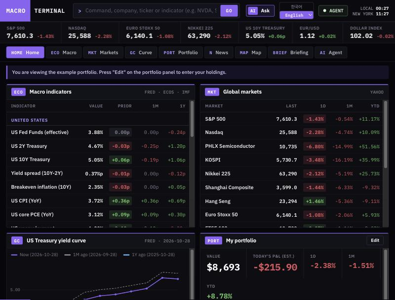

# Macro Terminal

[English](README.md)

거시 지표, 시장, 금리 곡선, 뉴스와 내 포트폴리오 업계를 한 화면에서 보는 자가 설치형 터미널입니다. AI 에이전트의 답은 원문과 자동으로 대조됩니다. 내 컴퓨터에서 돌아가고, 로컬 LLM과 외부 API를 모두 쓸 수 있습니다.



> **투자 조언이 아닙니다.** 리서치와 매매 기록을 위한 도구입니다. 매수·매도를 권유하지 않고, 증권사에 연결하지 않으며, 매매 앱은 모의 매매만 합니다. 모델의 답은 틀릴 수 있습니다.

## 기능

- **근거를 대조하는 에이전트:** 검색하고 기사를 읽고 시세를 확인합니다. 답의 발췌와 숫자를 원문과 자동으로 대조해 결과를 답 아래에 보여 주고, 대조에 실패하면 한 번 고쳐 씁니다.
- **승인 후 작업:** 화면을 열고 포트폴리오를 바꿀 수 있습니다. 포트폴리오 변경은 항상 승인을 받습니다.
- **매매일지(`/trade`):** 모의 주문, 메모, 판단 분석(감정 근거 대조), 행동 패턴, 성과 추적, 코칭 질문, AI 의견 채점.
- **말로 추가하는 나라별 지표:** 거시 지표는 미국이 기본입니다. 에이전트에게 "독일 실업률 추가해 줘"라고 하면 연결된 모델이 웹에서 데이터 경로를 찾고, 서버가 실제 시계열을 받아 봅니다. 저장 전에 승인 카드로 경로와 최신 값을 보여 줍니다. 앱에는 나라별 경로 목록이 들어 있지 않습니다.
- **터미널:** 거시 지표, 시장, 금리 곡선, 뉴스 지도, 일간·주간·월간 브리핑, 기업 페이지. 인터넷이 끊겨도 마지막 데이터를 보여 줍니다.

## 시작하기

Node.js 22.13 이상이 필요합니다.

```bash
npm install
npm run build
npm start
```

http://127.0.0.1:4810 을 열면 설정 화면에서 언어, 기본 구성, 모델을 고릅니다. 모델이 없어도 지표, 시장, 뉴스 원문은 볼 수 있습니다.

기업 개요는 선택 기능이고 Python이 필요합니다.

```bash
npm run setup:yfinance
```

## 모델 고르기

설정 화면에서 Ollama, llama.cpp, LM Studio(로컬)와 OpenAI, Anthropic, Google Gemini, OpenRouter 또는 `/chat/completions` 형식의 서버를 고를 수 있습니다. **연결 시험**이 답변, 구조화 출력, 도구 호출을 확인합니다. 에이전트에는 도구 호출이 필요합니다.

### 외부 API의 개인정보와 비용

로컬 모델을 쓰면 아래 데이터 출처에 보내는 조회 요청 말고는 밖으로 나가는 것이 없습니다. **외부 API를 쓰면 포트폴리오, 매매 메모, 대화 내용과 그 감정 분석이 그 제공자에게 전송되고, 호출마다 요금이 나갈 수 있습니다.**

그래서 API에서는 **"자동으로 모델 호출"**이 기본으로 꺼져 있습니다. 끄면 뉴스 번역·요약, 지도 태깅, 시작 브리핑은 버튼을 누를 때만 실행됩니다. 대화와 매매 분석은 사용할 때 모델을 부릅니다.

API 키는 `config/settings.json`(소유자만 읽기, Git 제외) 또는 `.env`에 저장되고 브라우저로 보내지 않습니다. 서버 주소를 바꾸면 저장된 키는 지워집니다. 서버는 `127.0.0.1`에서만 받습니다. 로그인이 없으니 네트워크에 노출하지 마세요.

## 설정과 언어

- 설정은 첫 실행 때 `config/presets/`에서 `config/settings.json`, `config/portfolio.json`으로 만들어지고 Git에서 제외됩니다.
- 기본 구성은 `global`(기본값)과 `korea`입니다. 둘 다 미국 거시 지표로 시작하고, 시장 목록·예시 포트폴리오·통화가 다릅니다. 기준 통화는 매매 기록이 쌓인 뒤에는 바꾸지 마세요.
- `blockedHosts`에 호스트를 넣으면 그 데이터 출처를 끕니다.
- 기본 언어는 영어와 한국어입니다. 다른 언어는 `npm run lang:add -- ja 日本語 Japanese ja-JP`로 추가합니다. [자세한 방법](docs/adding-a-language.md)

## 데이터 출처

출처별 약관이 있고, 일부는 공식 API가 아니어서 언제든 막힐 수 있습니다. 약관을 지킬 책임은 사용자에게 있으며 데이터를 재배포하지 마세요. 표는 [영어 README](README.md#data-sources)에 있습니다.

## 라이선스

[MIT](LICENSE)
