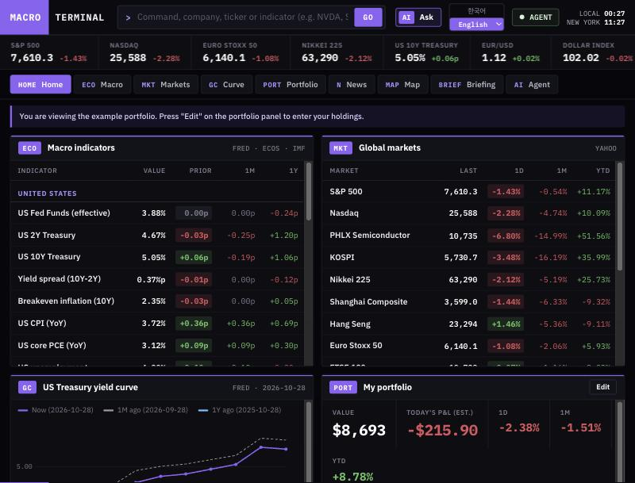

# Macro Terminal

[한국어](README.ko.md)

A self-hosted terminal for macro indicators, markets, yield curves, news and your portfolio's industries, with an AI agent whose answers are checked against their sources. It runs on your machine and works with a local LLM or an external API.



> **Not investment advice.** This is a research and journaling tool. It does not recommend buying or selling, does not connect to brokers, and its trading app is paper trading only. Model output can be wrong.

## What it does

- **Source-checked agent.** The agent searches, reads articles and looks up quotes. Excerpts and numbers in its answer are automatically compared with the original text, and the result is shown under the answer. Failed checks trigger one rewrite.
- **Tasks with approval.** The agent can open screens and change your portfolio. Portfolio changes always wait for your approval.
- **Trading journal (`/trade`).** Paper orders, notes, decision analysis with evidence-checked emotions, behavior patterns, outcome tracking, coaching questions and scoring of the AI's own opinions.
- **Add any country's indicators by asking.** Macro indicators start with the US. Tell the agent "add Germany unemployment": your model searches the web, works out the data path, and the server fetches the real series. An approval card shows the path and latest value before anything is saved. The app ships no list of country paths.
- **Terminal.** Macro indicators, markets, yield curve, news map, daily/weekly/monthly briefings and company pages. The last data stays on screen when you go offline.

## Quick start

Requires Node.js 22.13 or later.

```bash
npm install
npm run build
npm start
```

Open http://127.0.0.1:4810. The setup screen asks for a language, a starting configuration and a model. Indicators, markets and original headlines work without any model.

For development, use `npm run dev` on the same port.

Company profiles are optional and need Python:

```bash
npm run setup:yfinance
```

## Choosing a model

| Type | Server URL | Notes |
|---|---|---|
| Ollama | `http://127.0.0.1:11434/v1` | Local |
| llama.cpp | `http://127.0.0.1:8080/v1` | Local. `LLM_GGUF=/path/model.gguf npm run llm:local` starts it |
| LM Studio | `http://127.0.0.1:1234/v1` | Local |
| OpenAI | `https://api.openai.com/v1` | API key |
| Anthropic | `https://api.anthropic.com` | API key, native adapter |
| Google Gemini | `https://generativelanguage.googleapis.com/v1beta/openai` | API key, OpenAI-compatible endpoint |
| OpenRouter or other | your URL | Any `/chat/completions` server |

**Test connection** checks the three things the app needs: answers, structured output and tool calling. The agent needs tool calling; a model without it can still translate and summarize.

Small local models work. The app includes safeguards built for them, such as repeat cleanup and rewrite prompts.

### Privacy and cost with an external API

With a local model, nothing leaves your machine except data requests to the sources below. **With an external API, your portfolio, trade notes, chats and their emotion analysis are sent to that provider, and each call may cost money.**

For that reason **"Call the model automatically"** is off by default for APIs. When it is off, news translation, summaries, map tagging and startup briefings run only when you press a button. Chat and journal analysis still call the model when you use them.

API keys are stored in `config/settings.json` (owner-only permissions, ignored by Git) or can be set in `.env`. They are never sent to the browser, and a saved key is dropped if you change the server URL.

The server listens only on `127.0.0.1`. Do not expose it to a network: it has no login.

## Configuration

Your settings live in `config/settings.json` and `config/portfolio.json`, created from `config/presets/` on first run and ignored by Git, so updating the code does not touch them. Data is stored in `data/` and briefings in `reports/`, also ignored.

- **Presets:** `global` (default) and `korea`. Both start with US macro indicators; they differ in markets, example portfolio and currency. Add other countries through the agent, or edit `config/settings.json` to change indicators, markets, the yield curve, the top strip or news topics. Reload to apply.
- **Base currency:** set in setup. Do not change it after you have trade records, because their FX rates are stored in that currency.
- **Turn off a data source:** list hosts in `blockedHosts`, for example `"blockedHosts": ["www.bing.com"]`. Features using that source show no data.
- **Change the model at any time:** open `/setup`, or click the AGENT indicator.

## Languages

English and Korean ship by default. Adding another takes one command, and model output works right away:

```bash
npm run lang:add -- ja 日本語 Japanese ja-JP
```

See [docs/adding-a-language.md](docs/adding-a-language.md).

## Data sources

These sources belong to their owners and have their own terms. **Some are not official APIs, and access may stop working. You are responsible for following each source's terms. Do not redistribute the data.**

| Source | Used for | Access |
|---|---|---|
| [FRED](https://fred.stlouisfed.org/legal/terms/), Federal Reserve Bank of St. Louis | US indicators and the yield curve, plus any series the agent adds | Public site. Terms require attribution, limit some series to personal use and restrict machine-learning use |
| [IMF Data](https://data.imf.org) | Series the agent adds | Public API |
| [Bank of Korea ECOS](https://ecos.bok.or.kr/api/) | Series the agent adds, if you set a key | Official API, key required |
| [Wikidata](https://www.wikidata.org) | Company names | Public API, CC0 |
| Yahoo Finance, via direct requests and [yfinance](https://github.com/ranaroussi/yfinance) | Quotes, search, company profiles | **Unofficial.** yfinance is unaffiliated with Yahoo and intended for research and education |
| Google News RSS | Industry and macro news | **Unofficial use**, personal use |
| Bing News RSS, MSN | Agent news search | **Unofficial use** |
| Article pages, other public pages and CSV files | Text the agent reads, and CSV series you approve | Fetched on request; public addresses only |
| DuckDuckGo HTML, Bing RSS | Agent web search for data paths | **Unofficial use** |
| KRX | Korean company listing | **Unofficial use** |

This product uses FRED® data but is not endorsed or certified by the Federal Reserve Bank of St. Louis.

## Development

```bash
npm test
npm run typecheck
```

Next.js 16, React 19, TypeScript, SWR, zod and Vitest. All model calls go through `src/server/llm.ts`, and provider differences stay in `src/server/llm-providers.ts`. Code comments are mostly in Korean.

## License

[MIT](LICENSE)
